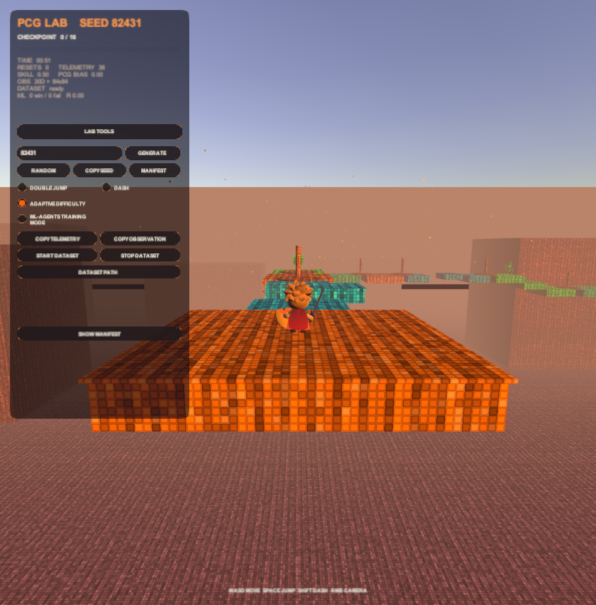
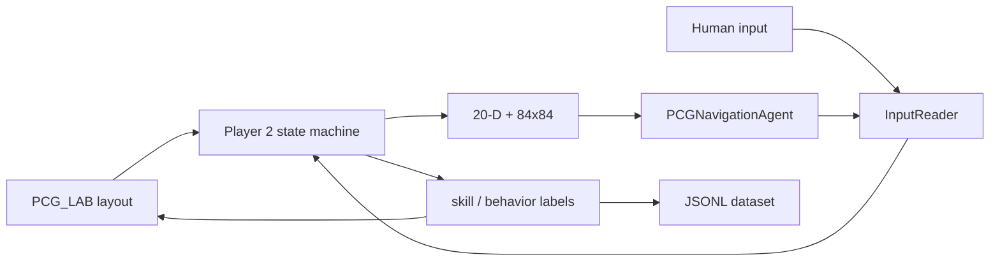

# Super Platformer 3D

A third-person 3D platformer on **Unity 2022.3.2f1** / URP 14. The main line of work is **PCG_LAB**: a playable lab that connects three systems.

1. **Procedural levels** — deterministic seeds, reachability, and rhythm
2. **Player modeling** — skill estimates, behavior labels, and a multimodal dataset
3. **ML-Agents navigation** — the same Player 2 controller, driven through an external InputReader channel; the PPO stack is wired, but no policy has been trained yet

Hand-authored `Level_Tutorial` and `Level_1` remain as the gameplay baseline and as visual reference for PCG chunks.

---

## Status

| System | Status |
|---|---|
| PCG_LAB | Playable. Default seed `82431`, 16 chunks, checkpoints, respawn, HUD |
| Player modeling | Live. Online skill estimate, 20-D observation, behavior labels, JSONL + 84x84 frames |
| ML-Agents | **Pipeline ready; no trained policy yet.** Agent, rewards, PPO yaml, and Python 3.9 trainer pins are in place. The first PPO baseline and a pass-rate table are the next step |

---

## PCG_LAB

Scene: [`Assets/_Project/Scenes/PCG_Lab.unity`](Assets/_Project/Scenes/PCG_Lab.unity)



```text
Play
 → LevelGenerator.Generate(seed)
 → rhythm beat + difficulty-at-progress
 → ChunkSelector (ability / reach / grammar / overlap)
 → instantiate chunk library
 → checkpoint at each exit
 → safest-chunk fallback on failure
```

- The same `seed + ability profile + config` always produces the same route
- 14 prototypes: straight, climb, descend, turn, offset, moving, timed, double-jump gate, dash gap, combat, recovery
- Player jump envelope is scaled by **0.82** before reachability checks
- Rhythm: Start → Easy → Normal → Challenge → Recovery → Reward
- Adaptive difficulty uses checkpoint time and respawns to retune moving/timed platforms and bias the next layout by `-0.2…+0.2`

Controls: WASD move, Space jump, Shift dash, hold RMB to look. The top-left HUD changes seed, toggles Double Jump / Dash, switches training mode, and records datasets. Double Jump and Dash start off; a toggle applies to the player at once and to the route on the next GENERATE.

Full rules: [docs/pcg.md](docs/pcg.md).

---

## Player modeling

PCG_LAB treats the player as an observable, not only a score.

**Online skill** — `PCGAdaptiveDifficultyDirector`

- Estimates skill in `[0, 1]` from checkpoint time and respawns
- Adjusts live platforms and the next generated layout

**Structured observation** — `PCGGameAIObservation` (fixed 20 values)

- Position, velocity, camera forward
- Progress, current chunk, reset count
- Next-chunk difficulty, skill estimate, difficulty bias
- Timed-platform visibility ratio, moving-platform count

**Behavior labels** (dataset)

`Idle` · `Traversing` · `Airborne` · `Falling` · `Recovery`

**Multimodal recorder** — `PCGMultimodalDatasetRecorder`

```text
persistentDataPath/PCGDatasets/<episode-id>/
  observations.jsonl    20-D vector + label + reward + timestamp
  frames/*.png          synced 84x84 RGB
  episode.json          seed, completion, resets, return, final skill
```

The same contract can feed behavior cloning, offline RL, or ML-Agents without coupling those consumers to generator internals.

---

## ML-Agents (in progress)

`PCGNavigationAgent`, behavior name **`PCGNavigation`**. It does **not** implement a second mover. Actions go through `InputReader` into the existing Player 2 state machine (move, jump, dash).

| Item | Contract |
|---|---|
| Observation | 20 normalized values + 84x84 RGB `RenderTextureSensor` |
| Actions | 2 continuous move axes + binary Jump / Dash branches |
| Decision | period = 5 |
| Rewards | checkpoint, completion, death, time, approach |
| Trainer | `com.unity.ml-agents` 2.0.1 + Python `mlagents==0.30.0` (Python 3.9) |
| PPO | [`Training/pcg_navigation_ppo.yaml`](Training/pcg_navigation_ppo.yaml), `max_steps: 1_000_000` |

```powershell
.\.venv-mlagents\Scripts\Activate.ps1
mlagents-learn Training\pcg_navigation_ppo.yaml --run-id=pcg-navigation-v1
```

When the trainer is listening, open `PCG_Lab`, enter Play Mode, and enable **ML-Agents Training Mode** in the HUD. Results go to `Training/results/` (gitignored).

Setup: [docs/training.md](docs/training.md).



---

## Quick start

1. Open this repo in **Unity 2022.3.2f1** (do not upgrade the editor)
2. Open `Assets/_Project/Scenes/PCG_Lab.unity`
3. Press Play
4. For training, set up the Python 3.9 venv as in [docs/training.md](docs/training.md)

Hand-authored flow is still `Level_Tutorial.unity` then `Level_1.unity`.

---

## Layout

```text
Assets/_Project/
  PCG/                   chunk prefabs and data
  Scenes/PCG_Lab.unity   lab scene
  Scripts/PCG/           generation, rhythm, reach, sensors, telemetry
  Scripts/PCGNavigationAgent.cs
  Prefabs/Player 2.prefab
Training/                PPO yaml and Python pins
docs/                    project documentation
```

| Type | Role |
|---|---|
| `LevelGenerator` / `ChunkSelector` | deterministic generation |
| `PCGPlayerReachModel` | safe reach from jump stats |
| `PCGAdaptiveDifficultyDirector` | online player skill |
| `PCGGameAIObservationSensor` | 20-D + 84x84 |
| `PCGMultimodalDatasetRecorder` | player-behavior dataset |
| `PCGNavigationAgent` | ML-Agents policy |

EditMode tests live under `Assets/_Project/Tests/PCG/` (40 tests). Play Mode is the primary smoke test.

---

## Stack

Unity 2022.3.2f1 · URP 14.0.8 · Input System 1.6.1 · Cinemachine 2.9.7 · AI Navigation 1.1.7 · ML-Agents 2.0.1

Docs: [architecture](docs/agents.md) · [PCG Lab](docs/pcg.md) · [training](docs/training.md) · [level design](docs/level-design.md) · [changelog](docs/changelog.md)
