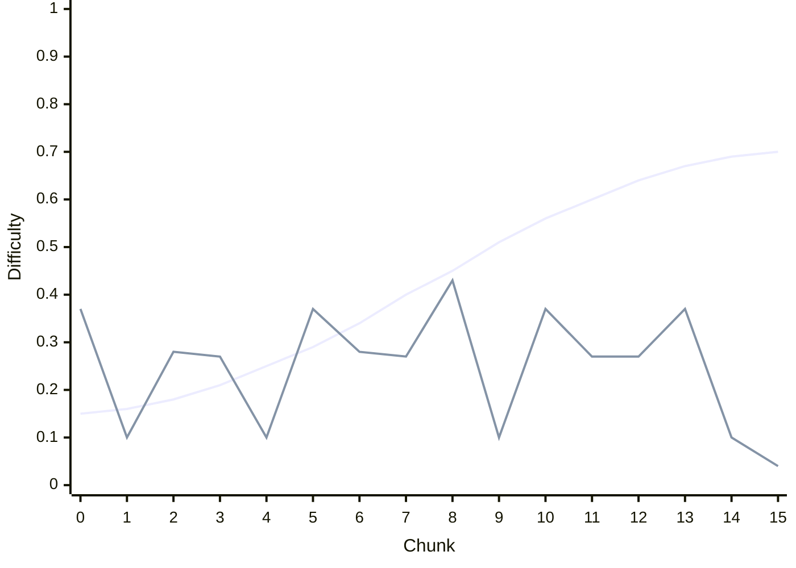

# PCG generation report

Written by `Platformer > PCG > Write Generation Report` (batch mode: `-executeMethod PCGGenerationReport.WriteBatchMode`). Do not edit by hand.

Seeds 1-100 for each ability profile, 16 chunks per level. Reach comes from the `Player 2` prefab: 5.02m horizontal and 0.42m vertical without abilities. Quality columns average completed levels only; raw rows are in `levels.csv`.

| Abilities | Completed | Deterministic | Safe-fallback chunks | Mean difficulty error | Distinct chunks / level | Elevation span (m) | Heading changes / level |
|---|---|---|---|---|---|---|---|
| none | 99/100 | 100/100 | 0/1584 | 0.22 | 7.84 | 4.00 | 3.87 |
| double jump | 97/100 | 100/100 | 1/1552 | 0.21 | 9.32 | 6.34 | 4.22 |
| dash | 98/100 | 100/100 | 0/1568 | 0.21 | 8.13 | 4.00 | 3.71 |
| double jump + dash | 99/100 | 100/100 | 0/1584 | 0.20 | 9.51 | 6.22 | 4.09 |

## Seed 82431, no abilities

First line: target difficulty from the progress curve and rhythm plan. Second line: difficulty of the chunk actually placed.

Chunks: `moving_01` → `basic_01` → `descend_01` → `turn_right_01` → `basic_01` → `moving_01` → `descend_01` → `turn_right_01` → `timed_01` → `basic_01` → `moving_01` → `turn_left_01` → `turn_right_01` → `moving_01` → `basic_01` → `recovery_01`
