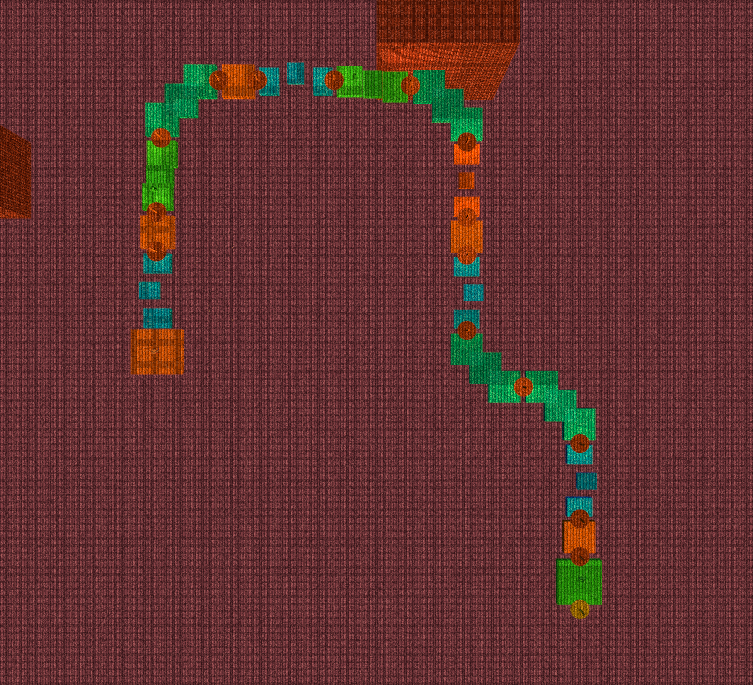
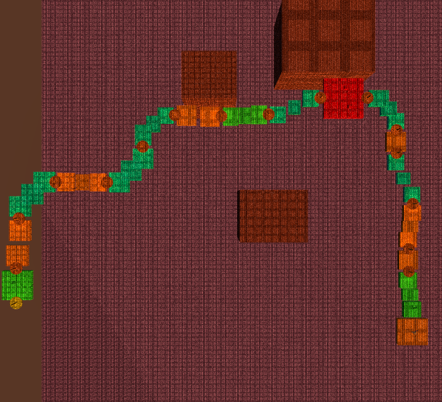

# PCG Lab: a level generator, a failure that tests missed, and how measuring found it

PCG_LAB is a deterministic, chunk-based level generator for a third-person 3D
platformer. It turns a seed and the player's abilities into a 16-chunk route that
the player can physically traverse. The lab is the testbed for the project's
adaptive-difficulty and game-playing-agent work, so its levels have to be valid,
reproducible, and measurable.

<table>
<tr>
<td></td>
<td></td>
</tr>
<tr>
<td>Seed 82431, no abilities</td>
<td>Same seed, double jump unlocked</td>
</tr>
</table>

Same seed, same random stream, different route: unlocking double jump makes climbing
chunks legal, so the generator turns, climbs, and reaches a combat chunk (red) that the
no-ability route never offers. Colors mark chunk categories.

## How it works

For each of the 16 slots, the generator:

1. Reads a target difficulty from a progress curve and a rhythm plan
   (start, easy, challenge, recovery, reward).
2. Filters the 14-chunk library by three hard contracts and two soft preferences:
   - **Ability gate.** Double-jump and dash chunks need the ability unlocked.
   - **Reachability.** Each chunk declares the horizontal and vertical reach it needs.
     The player's reach comes from the controller's jump and move parameters, scaled by
     a 0.82 safety factor.
   - **Elevation band.** The route stays within -4 m to +8 m of the start.
   - **Spatial grammar (soft).** At most three flat or three straight chunks in a row.
   - **Category repetition (soft).** At most two chunks of the same category in a row.
3. Picks a chunk by weight (difficulty match × rhythm), aligns its entry socket to the
   previous exit, rejects overlaps, and places a checkpoint at the exit.
4. Records everything in a JSON manifest. The same seed, config, and abilities always
   produce a byte-identical manifest.

## What measuring found

On 2026-10-14, double jump and dash were made off by default to match the HUD and the
tutorial unlocks. Everything still looked fine: every seed produced 16 chunks, and all
39 tests passed.

Reading the per-chunk manifests told a different story. With no abilities, the last
six chunks of the default seed were all `recovery_01`, the safest fallback, while the
target difficulty climbed to 0.70. Across seeds 1-50, 356 of 800 chunks were fallbacks.

The cause was a chain of individually reasonable rules:

1. The controller-derived vertical reach is 0.42 m. Every climbing chunk needs at least
   1.0 m, so none was legal.
2. With only descents available, the route hit the -4 m floor within a few chunks.
3. After three flat chunks, the grammar demanded an elevation change. Nothing could
   satisfy it, so the generator fell back to `recovery_01`.
4. `recovery_01` is flat, so the flat counter never reset. Every later chunk fell back.

The tests missed it because they used hand-set reach values (1.8 m vertical), not the
values derived from the player.

## The fix

The spatial grammar now acts as a preference. When no legal chunk satisfies it, the
generator relaxes the elevation rule, then the direction rule, and only then uses the
safe fallback. Manifests now flag fallback chunks, and a regression test generates 11
seeds with the player-derived reach and no abilities.

| Seeds 1-50, no abilities | Before (`f79d1069`) | After (`fc608aef`) |
|---|---|---|
| Safe-fallback chunks | 356/800 | 0/800 |
| Mean target-vs-actual difficulty error | 0.315 | 0.218 |

## Evaluation

`Platformer > PCG > Write Generation Report` generates seeds 1-100 for each ability
profile and writes [pcg-eval/summary.md](pcg-eval/summary.md) and
[pcg-eval/levels.csv](pcg-eval/levels.csv). The numbers below are copied from that
report.

| Abilities | Completed | Deterministic | Safe-fallback chunks | Mean difficulty error | Distinct chunks / level | Elevation span (m) |
|---|---|---|---|---|---|---|
| none | 99/100 | 100/100 | 0/1584 | 0.22 | 7.84 | 4.00 |
| double jump | 97/100 | 100/100 | 1/1552 | 0.21 | 9.32 | 6.34 |
| dash | 98/100 | 100/100 | 0/1568 | 0.21 | 8.13 | 4.00 |
| double jump + dash | 99/100 | 100/100 | 0/1584 | 0.20 | 9.51 | 6.22 |

Determinism holds for all 400 levels. Abilities widen the usable library and the
vertical range, as intended. The report also exposes what the generator cannot do yet.

## Known limits

- **Difficulty ceiling.** Without abilities, the hardest legal chunk is the timed
  platform (0.43). The target curve reaches 0.70, so the second half of a no-ability
  level is easier than planned. This is a content gap, not a selection bug: the library
  needs harder chunks that do not require abilities.
- **No backtracking.** 1-3% of levels spiral into their own path and fail on overlap.
  This happened before the fix too. A one-step backtrack would remove most of these.
- **Reach model vs. the real jump.** Measured in Play Mode, a held jump reaches about
  1.22 m and stays airborne about 0.6 s, and hold time barely changes the height. The
  closed-form model predicts 0.42 m vertical and 1.02 s airtime. Calibrating reach from
  recorded jumps instead of formulas is the next step for the reachability contract.
- **The navigation agent is not trained yet.** The observation, action, and reward
  contracts exist, but there is no PPO baseline.

## Reproduce

Close the Editor, then from the repository root in PowerShell:

```powershell
$UnityExe = 'D:\unity eiditor\Unity 2022.3.2f1\Editor\Unity.exe'  # adjust per machine
$Project = (Resolve-Path .).Path
Start-Process $UnityExe -Wait -ArgumentList @('-batchmode', '-projectPath', $Project,
  '-executeMethod', 'PCGGenerationReport.WriteBatchMode', '-logFile', "$Project\Logs\pcg-report.log")
```

Failed levels log `PCG generation failed: ...` in that log file, as expected for the
overlap cases above.
